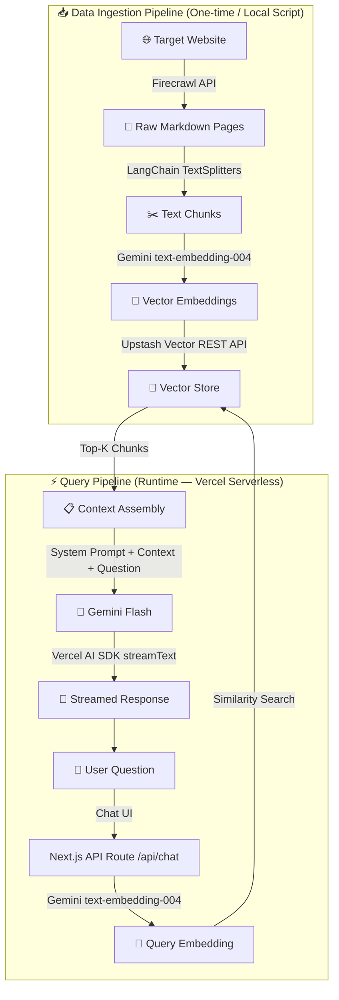
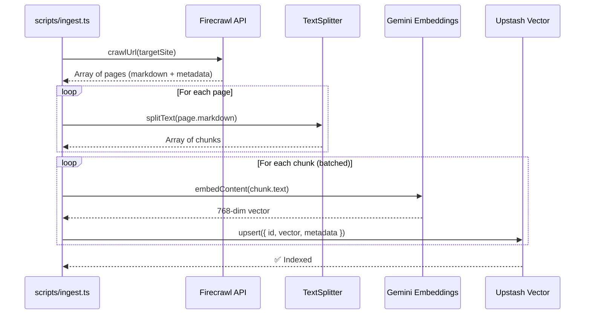
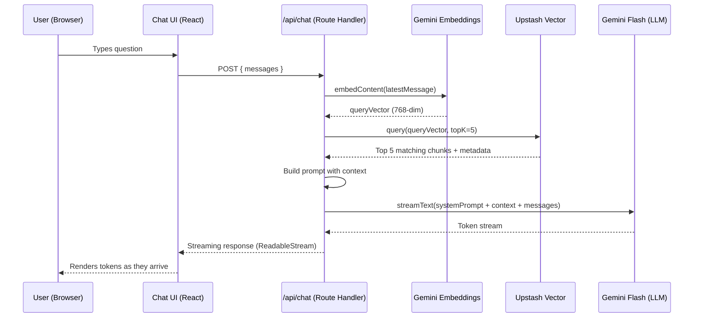
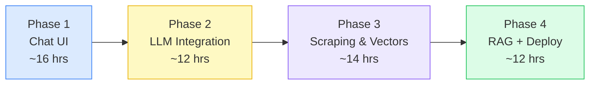

# RAG Chatbot — Architecture

## Overview

A serverless RAG (Retrieval-Augmented Generation) chatbot that scrapes a website, builds a searchable knowledge base, and answers user questions grounded in that content — with streaming responses.

---

## System Architecture



---

## Two Distinct Pipelines

### Pipeline 1 — Data Ingestion (Offline)

Runs **locally via `tsx`** — not deployed to Vercel. This is a one-time (or periodic) script.



| Step       | Tool                             | Details                                          |
| ---------- | -------------------------------- | ------------------------------------------------ |
| **Scrape** | Firecrawl                        | Crawl target site, get clean markdown per page   |
| **Chunk**  | `RecursiveCharacterTextSplitter` | ~500-1000 chars per chunk, ~200 char overlap     |
| **Embed**  | Gemini `text-embedding-004`      | 768-dimension vectors (free tier)                |
| **Store**  | Upstash Vector                   | REST-based, serverless, stores vector + metadata |

> [!TIP]
> Store **source URL** and **chunk text** as metadata in Upstash so you can display sources alongside answers.

---

### Pipeline 2 — Chat / Query (Runtime)

Runs on **Vercel serverless functions** via Next.js API routes.



---

## Project Structure

```
rag-chatbot/
├── src/
│   ├── app/
│   │   ├── layout.tsx                # Root layout
│   │   ├── page.tsx                  # Chat page
│   │   └── api/
│   │       └── chat/
│   │           └── route.ts          # POST handler — RAG + streaming
│   │
│   ├── components/
│   │   ├── chat/
│   │   │   ├── chat-container.tsx    # Main chat wrapper
│   │   │   ├── message-list.tsx      # Scrollable message list
│   │   │   ├── message-bubble.tsx    # Single message (user/assistant)
│   │   │   └── chat-input.tsx        # Input bar with send button
│   │   └── ui/                       # shadcn/ui components (auto-generated)
│   │
│   ├── lib/
│   │   ├── gemini.ts                 # Google Generative AI client
│   │   ├── upstash.ts                # Upstash Vector index client
│   │   └── prompts.ts                # System prompt + context template
│   │
│   └── types/
│       └── index.ts                  # Shared TypeScript types
│
├── scripts/
│   ├── ingest.ts                     # Full ingestion orchestrator
│   └── clear-index.ts                # Utility: wipe vector store
│
├── .env.local                        # API keys (gitignored)
├── next.config.ts
├── tailwind.config.ts
├── components.json                   # shadcn/ui config
├── package.json
└── tsconfig.json
```

---

## Key Components

### 1. Environment Variables (`.env.local`)

```env
# Gemini
GOOGLE_GENERATIVE_AI_API_KEY=your_gemini_api_key

# Upstash Vector
UPSTASH_VECTOR_REST_URL=your_upstash_vector_url
UPSTASH_VECTOR_REST_TOKEN=your_upstash_vector_token

# Firecrawl (only needed for ingestion script)
FIRECRAWL_API_KEY=your_firecrawl_api_key
```

### 2. API Route (`/api/chat/route.ts`)

Responsibilities:

1. Extract the latest user message from the conversation
2. Embed it using Gemini's embedding model
3. Query Upstash Vector for the top-K similar chunks
4. Assemble a system prompt with retrieved context
5. Call Gemini via Vercel AI SDK's `streamText()`
6. Return the streaming response

### 3. Chat UI

Uses `useChat()` hook from Vercel AI SDK — handles:

- Message state management
- Streaming display
- Auto-scroll
- Loading states
- Error handling

### 4. Ingestion Script (`scripts/ingest.ts`)

Run locally with `npx tsx scripts/ingest.ts`:

1. Crawl target URL with Firecrawl
2. Split each page's markdown into chunks
3. Generate embeddings for each chunk (batched)
4. Upsert vectors + metadata into Upstash

---

## Data Model

### Vector Record (stored in Upstash)

```typescript
{
  id: string;              // Unique ID (e.g., "page-url#chunk-0")
  vector: number[];        // 768-dim embedding from Gemini
  metadata: {
    text: string;          // The actual chunk text (for retrieval)
    source: string;        // Source page URL
    title: string;         // Page title
    chunkIndex: number;    // Position within the page
  }
}
```

---

## Tech Stack Summary

| Layer          | Technology                                 | Purpose                       |
| -------------- | ------------------------------------------ | ----------------------------- |
| **Frontend**   | Next.js (App Router) + React               | Chat UI with SSR              |
| **Styling**    | Tailwind CSS + shadcn/ui                   | Responsive, polished UI       |
| **Chat Hook**  | Vercel AI SDK (`useChat`)                  | Client-side streaming + state |
| **API**        | Next.js Route Handlers                     | Serverless backend            |
| **LLM**        | Gemini 3.5 Flash Lite                      | Answer generation             |
| **Embeddings** | Gemini `text-embedding-004`                | Text → vector conversion      |
| **Vector DB**  | Upstash Vector                             | Serverless similarity search  |
| **Scraping**   | Firecrawl                                  | Website → clean markdown      |
| **Chunking**   | LangChain `RecursiveCharacterTextSplitter` | Split text for embedding      |
| **Hosting**    | Vercel (Hobby)                             | Free serverless deployment    |

---

## Request Flow (Simplified)

```
User types "How does X work?"
        │
        ▼
   ┌─────────────┐
   │  useChat()   │  ← Vercel AI SDK React hook
   │  POST /api/  │
   └──────┬───────┘
          │
          ▼
   ┌─────────────────┐
   │  Embed query     │  ← Gemini text-embedding-004
   │  (768-dim vec)   │
   └──────┬───────────┘
          │
          ▼
   ┌─────────────────┐
   │  Vector search   │  ← Upstash: top 5 similar chunks
   └──────┬───────────┘
          │
          ▼
   ┌──────────────────────────────────────────┐
   │  Prompt = System Instructions             │
   │         + Retrieved Context (5 chunks)    │
   │         + Conversation History            │
   │         + User Question                   │
   └──────┬───────────────────────────────────┘
          │
          ▼
   ┌─────────────────┐
   │  Gemini Flash    │  ← streamText() via Vercel AI SDK
   │  generates answer│
   └──────┬───────────┘
          │
          ▼
   ┌─────────────────┐
   │  Stream tokens   │  ← ReadableStream back to client
   │  to chat UI      │
   └──────────────────┘
```

---

## Key Design Decisions

| Decision                                | Rationale                                                                        |
| --------------------------------------- | -------------------------------------------------------------------------------- |
| **Ingestion runs locally**              | Avoids Vercel function size/time limits; Firecrawl + embedding is a long process |
| **Chunk size ~800 chars, overlap ~200** | Balances context richness vs. embedding quality                                  |
| **Top-K = 5**                           | Good starting point; tune based on answer quality                                |
| **Metadata includes chunk text**        | Avoids a separate database — Upstash stores everything                           |
| **Streaming responses**                 | Much better UX — user sees tokens immediately                                    |
| **App Router (not Pages)**              | Modern Next.js pattern, better for Route Handlers                                |

> [!IMPORTANT]
> **Upstash Vector free tier supports 10K vectors.** For a typical documentation site, this is plenty. If you're scraping a very large site, you may need to be selective about which pages to index.

---

## Implementation Roadmap

**Total Budget:** 3 weeks × 20 hrs/week = **60 hours**



> [!NOTE]
> **~6 hours of buffer** are built into the plan. Each phase produces a working milestone you can demo — you're not just copying code, you're understanding how each piece works.

---

### Phase 1 — Chat UI (~16 hours) `Week 1`

Build a fully functional chat interface — no AI yet, just the shell.

| Day    | Task                            | Hours | Details                                                                                                                                      |
| ------ | ------------------------------- | ----- | -------------------------------------------------------------------------------------------------------------------------------------------- |
| **D1** | Project scaffold - done         | 3     | Initialize Next.js (App Router, TypeScript, Tailwind), install shadcn/ui, configure project structure, set up Git repo                       |
| **D2** | Chat layout - done              | 4     | Build `chat-container.tsx`, `message-list.tsx`, `message-bubble.tsx`, `chat-input.tsx`. Use shadcn `Button`, `Input`, `ScrollArea`, `Avatar` |
| **D3** | Chat logic (mock) - done        | 4     | Wire up local state for messages, handle send, auto-scroll, loading states. Use mock echo responses to test the flow                         |
| **D4** | Styling & responsiveness - done | 3     | Polish the UI — dark/light mode toggle, mobile responsive, empty state, typing indicator animation                                           |
| **D5** | Markdown rendering - done       | 2     | Install `react-markdown` + `remark-gfm` to render assistant messages as rich markdown                                                        |

**Milestone:** A polished chat UI that echoes back messages with mock responses.

```
✅ Checkpoint: Run `npm run dev`, send messages, see them rendered beautifully.
   No API keys needed yet.
```

---

### Phase 2 — LLM Integration (~12 hours) `Week 2, first half`

Connect Gemini via Vercel AI SDK for real conversational AI.

| Day    | Task                         | Hours | Details                                                                                                                                     |
| ------ | ---------------------------- | ----- | ------------------------------------------------------------------------------------------------------------------------------------------- |
| **D6** | API keys & clients - done    | 2     | Get Gemini API key from [Google AI Studio](https://aistudio.google.com/apikey). Create `.env.local`. Set up `src/lib/gemini.ts`             |
| **D7** | API route + streaming - done | 4     | Build `src/app/api/chat/route.ts` — accept messages, call Gemini via `@ai-sdk/google` + `streamText()`, return streaming response           |
| **D8** | Connect UI to API - done     | 3     | Replace mock logic with Vercel AI SDK's `useChat()` hook. Wire to `/api/chat`. Handle streaming, errors, loading                            |
| **D9** | System prompt & polish - done | 3     | Craft a system prompt in `src/lib/prompts.ts` (persona for Sreedhareeyam assistant). Add conversation history support. Test multi-turn chat |

**Milestone:** A working AI chatbot powered by Gemini — general knowledge, no RAG yet.

```
✅ Checkpoint: Ask "What is Ayurveda?" and get a streamed response from Gemini.
   The bot works but doesn't know anything specific about Sreedhareeyam yet.
```

---

### Phase 3 — Scraping & Vector Generation (~14 hours) `Week 2, second half → Week 3`

Build the data ingestion pipeline — scrape, chunk, embed, store.

| Day     | Task                | Hours | Details                                                                                                                                                                                                 |
| ------- | ------------------- | ----- | ------------------------------------------------------------------------------------------------------------------------------------------------------------------------------------------------------- |
| **D10** | Set up services     | 3     | Create [Upstash Vector](https://console.upstash.com/) index (768 dimensions, cosine metric). Get [Firecrawl](https://www.firecrawl.dev/) API key. Add keys to `.env.local`. Set up `src/lib/upstash.ts` |
| **D11** | Scraping script     | 3     | Build `scripts/ingest.ts` — use Firecrawl to crawl `https://www.sreedhareeyam.com/`. Log pages found, inspect markdown output quality                                                                   |
| **D12** | Chunking            | 3     | Add `RecursiveCharacterTextSplitter` (800 chars, 200 overlap). Split scraped markdown into chunks. Log chunk count and sample chunks                                                                    |
| **D13** | Embedding & storage | 3     | Use Gemini `text-embedding-004` to embed each chunk. Batch upsert into Upstash Vector with metadata (text, source URL, title). Build `scripts/clear-index.ts` utility                                   |
| **D14** | Verify & iterate    | 2     | Query Upstash Vector manually with test queries. Check if relevant chunks are returned. Re-tune chunk size/overlap if needed                                                                            |

**Milestone:** Sreedhareeyam website content is fully indexed in Upstash Vector.

```
✅ Checkpoint: Run `npx tsx scripts/ingest.ts` and see all chunks stored.
   Query Upstash dashboard to verify vectors exist with correct metadata.
```

---

### Phase 4 — RAG + Deployment (~12 hours) `Week 3`

Connect retrieval to generation — the bot now answers from real knowledge.

| Day     | Task                 | Hours | Details                                                                                                                                            |
| ------- | -------------------- | ----- | -------------------------------------------------------------------------------------------------------------------------------------------------- |
| **D15** | RAG in API route     | 4     | Update `/api/chat/route.ts`: embed user query → search Upstash (top 5) → inject retrieved chunks into system prompt → generate answer with context |
| **D16** | Source citations     | 2     | Display source URLs alongside answers. Add "Sources" section below assistant messages in the UI                                                    |
| **D17** | Prompt engineering   | 2     | Refine the system prompt — instruct the model to only answer from provided context, handle "I don't know" gracefully, format responses well        |
| **D18** | Testing & edge cases | 2     | Test with various question types: factual, comparison, off-topic. Handle edge cases (no results found, API errors, rate limits)                    |
| **D19** | Deploy to Vercel     | 2     | Push to GitHub, connect to Vercel, add environment variables, deploy. Test the live URL on different devices                                       |

**Milestone:** Fully deployed RAG chatbot answering questions about Sreedhareeyam.

```
✅ Checkpoint: Visit your-app.vercel.app, ask "What treatments does Sreedhareeyam offer?"
   and get an accurate, sourced answer streamed from your RAG pipeline.
```

---

### Hour Summary

| Phase       | Focus                                | Hours | Cumulative |
| ----------- | ------------------------------------ | ----- | ---------- |
| **Phase 1** | Chat UI                              | 16    | 16         |
| **Phase 2** | LLM Integration                      | 12    | 28         |
| **Phase 3** | Scraping & Vectors                   | 14    | 42         |
| **Phase 4** | RAG + Deploy                         | 12    | 54         |
| **Buffer**  | Debugging, learning, experimentation | 6     | **60**     |

> [!TIP]
> **Don't rush phases.** Each phase produces a working milestone you can demo. If you finish early, use the buffer time to improve prompt quality, add features (like suggested questions), or polish the UI.
